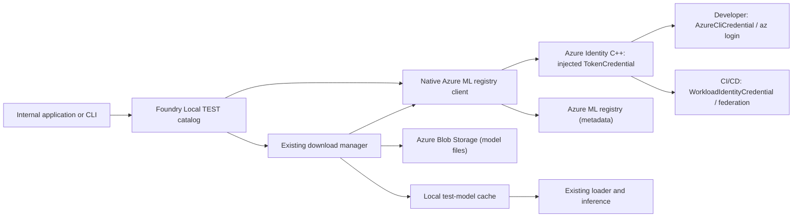

# Test Model Catalog Design

Status: Python-first implementation; online and cache-only E2E verified on Windows ARM64  
Updated: November 9, 2026

## 1. Goal

Let internal developers and CI/CD discover, download, load, and run models from a **default Azure ML test registry or their own registry**. Developers use existing **`az login` credentials**; CI/CD uses **workload identity federation without Azure CLI**.

This is a simpler, internal development and testing alternative to the [Private Model Catalog](private-model-catalog-design.md). No Azure Function, FPC service, application login, managed identity, shared secret, or separate authentication API is required. Registry access still requires authentication and RBAC; public network access does not enable anonymous access.

**Use Azure SDK for C++ components for authentication, a small native REST client for Azure ML, and the existing Foundry Local download/load/run pipeline.** Azure CLI is required only to reuse the developer's `az login` session; its `ml` extension and a Python runtime embedded in the application are not required.

## 2. Architecture



`TestModelCatalog` derives from `AzureModelCatalog` to reuse hardware/EP eligibility and the shared `BaseModelCatalog` behavior, selected explicitly with `CatalogType.TEST`. Public remains the default; public, local, and test catalogs stay separate. There is no aggregation or fallback. This first implementation exposes the feature only in the Python SDK and its shared native backend; other language SDKs and the CLI are unchanged.

| Concern | Decision |
|---|---|
| Registry | Default to `prathikrao-pmc-test`; allow an optional `registry_name` when requesting a test catalog |
| Registry configuration | Discover the endpoint and subscription/resource identity from the registry name; keep identity configuration separate from registry selection |
| Authentication | Inject an Azure Core `TokenCredential`: `AzureCliCredential` for developers, `WorkloadIdentityCredential` for CI/CD, and a fake credential for unit tests; never log tokens |
| Azure integration | One native Azure ML REST client behind the Python SDK; no Python Azure ML dependency |
| Discovery | Read model versions and metadata through authenticated Azure ML requests |
| Downloads | Resolve temporary artifact access through Azure ML, then use the existing downloader |
| Execution | Use the existing Foundry Local loader and inference APIs unchanged |
| Dependencies | Link Azure Identity/Core C++ libraries; only the developer login path requires Azure CLI, without the `ml` extension |

There is no Azure ML C++ equivalent of Python's `MLClient`. Implement only the operations this catalog needs: registry discovery, model list/get, and artifact-access resolution. Do not port the entire Python SDK. `AzureCliCredential` still invokes Azure CLI for token acquisition; model operations and transfers do not run `az ml` subprocesses.

## 3. Developer setup

Foundry Local reuses the active Azure CLI login; no tenant ID, storage keys, or additional sign-in is required. With registry model-read and artifact-download permissions already granted, developers only need to sign in and select the subscription:

```powershell
az login
az account set --subscription <test-subscription-id>
```

For a developer-owned registry, select its subscription and pass its name to `get_catalog`. The same Azure login must have model-read and artifact-download permissions there.

### CI/CD setup (no Azure CLI)

Use the same registry with an Azure DevOps Azure Resource Manager service connection configured for workload identity federation. Grant its identity the required registry model-read and artifact-access permissions.

The pipeline must explicitly pass the federated identity to the native test process; a service connection alone does not authenticate it. Configure `WorkloadIdentityCredential` with `AZURE_TENANT_ID`, `AZURE_CLIENT_ID`, and `AZURE_FEDERATED_TOKEN_FILE`. Use a pipeline task or helper that obtains the service connection's federated assertion without invoking Azure CLI and writes it to a restricted temporary file. Refresh the assertion before expiry for longer jobs; Azure Identity handles the subsequent access-token exchange and refresh.

Select workload identity explicitly in CI and inject it into the registry client. Do not fall back to a cached developer login or a broad credential chain. No `az login`, Azure CLI installation, or client secret is needed. Remove the token file after the job and never publish it in logs, caches, or artifacts.

## 4. Publishing and discovering models

Publish each hardware variant as an Azure ML custom model with an explicit version. Its artifact directory must contain `genai_config.json` at its root and all referenced model/tokenizer files. Use the existing model package layout rather than inventing a new archive format.

**Use plain Azure ML registry tags for publishing, then implement a native adapter that converts those tags into Foundry Local's normalized system/variant metadata and `ModelInfo`.** Reuse the existing hardware/EP filtering and variant selection rather than adding a parallel filter engine.

```text
Azure ML registry tags
    -> Native metadata adapter
    -> Existing Foundry Local system/variant metadata and ModelInfo
    -> Existing filtering and variant selection
```

| Tag | Example | Adapter mapping |
|---|---|---|
| `alias` | `smollm2-135m-instruct` | Catalog `systemCatalogData.alias` / `ModelInfo.alias` |
| `task` | `chat-completion` | Catalog `systemCatalogData.inferenceTasks` / `ModelInfo.task` |
| `device` | `CPU` | Catalog `variantInfo.variantMetadata.device` / `ModelInfo.device_type` |
| `execution_provider` | `CPUExecutionProvider` | Catalog `variantInfo.variantMetadata.executionProvider` / `ModelInfo.execution_provider` |
| `os` | `windows` | Adapter validates host OS compatibility before selection |
| `architecture` | `x64` | Adapter validates host architecture compatibility before selection |

Implement the proposed tag-to-metadata adapter in `test_model_catalog`, reusing Foundry Local's metadata conversion and hardware/EP selection. Add OS/architecture validation before selection.

Each Azure ML model name identifies a variant; `alias` groups variants. Use positive integer versions supported by Foundry Local and pin the selected variant/version for download and load. Exact `<variant-name>:<version>` lookup is also supported.

Tags use these exact, unprefixed keys; the former `foundry.*` names are no longer read. An asset opts in with a hardware/platform tag (`device`, `execution_provider`, `os`, or `architecture`) or the legacy `foundryLocal` marker. Generic `alias`/`task` tags alone do not opt in, so unrelated registry assets are ignored. Opted-in assets must supply all six tags, except for the legacy format below. Existing normalized cache snapshots remain usable without migration.

For existing registries such as `azureml-dev`, an asset marked with `foundryLocal`, with a recognized backend/device suffix and no hardware/platform tags, can use its existing `alias` and `task` tags. The adapter reuses execution-provider mappings for CPU, CUDA, WebGPU, OpenVINO, QNN, TensorRT RTX, VitisAI, RyzenAI, and AMDGPU. Established suffixes include `generic-cpu`, `generic-gpu`, `cuda-gpu`, `webgpu-gpu`, `openvino-gpu`, `openvino-npu`, `qnn-npu`, `trtrtx-gpu`, and `vitis-npu`. Generic GPU packages retain existing CUDA/WebGPU/DirectML selection. Unknown backend suffixes are explicitly skipped rather than treated as CPU.

The adapter logs the legacy mapping and leaves final platform admission to the runtime when loading the actual package. Listings include only variants matching a registered device and execution provider; OpenVINO GPU and NPU are checked separately. Cached snapshots retain all adapted metadata so registering another provider can expose its variants without rewriting registry assets. Legacy entries missing `alias`/`task` or using unsupported versions are skipped with warnings. If any hardware/platform tag is supplied, all six tags are still required. This compatibility path does not modify registry metadata.

In shared-host mode, PUBLIC and TEST queries refresh device/provider eligibility from the host without acquiring an owner or registering providers in the client. A changed device map invalidates existing catalogs, and newly created TEST registry catalogs inherit the current map. When no host is running, eligibility uses the client's registered providers.

Discovery reads model versions and tags, following pagination. Default discovery returns only the highest numeric version of each compatible model name (hardware variant), while retaining each hardware backend under its alias. Exact `<variant-name>:<version>` lookup can still request older versions, using a completed cached package first or querying that registry version otherwise. Explicit version-history queries retain all versions, subject to their requested limit. Cache-only discovery returns the latest downloaded version per variant; exact IDs can still select older downloaded versions. Ignore untagged assets and report incomplete or invalid tags. Return an explicit error when no compatible variant exists.

## 5. Using the catalog

Latest-only listings and retained exact-version handles have separate ownership. Looking up an older version never adds it to listing alias containers, and listing or refreshing never retires that exact handle. Exact handles remain available for download/load/unload for the catalog's lifetime; cached/loaded queries include them without duplicate IDs. Already-indexed metadata is reused without an extra registry request.

Discovery preserves resource-group names containing parentheses and Unicode, validating UTF-8, length and ASCII naming boundaries locally while leaving Unicode categories to ARM. The group is URL-encoded as one path segment, independently of model-name validation.

An exact model-version HTTP 404 returns no variant (`None` from Python's `get_model_variant()`), without changing existing model metadata. Authentication, authorization and transport failures still propagate. Discovery/listing 404s and missing model versions or artifact grants during downloads remain errors.

With the manager already initialized using the updated native library (C API version 4):

```python
from foundry_local_sdk import CatalogType

catalog = manager.get_catalog(CatalogType.TEST)

# Optional: use a developer-owned registry instead.
catalog = manager.get_catalog(
    CatalogType.TEST,
    registry_name="prathikrao-pmc-test",
)

model = catalog.get_model("smollm2-135m-instruct")
if model is None:
    raise LookupError("No compatible test model found")

model.download()
model.load()
# Use the existing inference APIs.
model.unload()
```

`registry_name` is the only optional connection input. Omit it to use `TestModelRegistry` from native configuration, or `prathikrao-pmc-test` by default. No credential object, token callback, endpoint, subscription, resource group, or tenant argument is needed.

Python `Configuration.additional_settings` accepts:

| Setting | Values |
|---|---|
| `TestModelCredential` | `azure_cli` (default outside CI) or `workload_identity`; detected CI requires explicit `workload_identity` |
| `TestModelRegistry` | Optional default registry name; an explicit `registry_name` takes precedence |
| `TestModelCacheOnly` | Optional strict offline mode: `"true"` prohibits registry access, including on misses and listing; default `"false"` still uses completed cached models first |

Other SDKs and CLI selection are deferred. Existing catalog enum values and earlier C API table entries remain unchanged; Python negotiates older APIs for public/local catalogs but requires version 4 for TEST.

## 6. Download and cache behavior

Place registry directories alongside the existing publisher directories under the same model cache root (`<appdir>` below represents `Configuration.model_cache_dir`, not the application installation directory):

```text
<appdir>\
  Microsoft\                              Existing public cache: unchanged
  <registry-name>-<registry-key>\
    <variant-name>-<version>\
      genai_config.json
      model.onnx
      inference_model.json
```

`registry-name` is the lowercase registry name; `registry-key` is the full SHA-256 hash of `azureml://registries/<lowercase-registry-name>`. These directories sit directly beside `Microsoft`, without a `_test_registries` parent. Public-cloud registry names identify the source without online discovery, so a separate process can open an offline snapshot using just the registry name. The ARM resource ID is retained in model metadata, not used to bootstrap the cache. Azure public-cloud authentication is used; discovered regional endpoints can be under `experiments.azureml.net` or `experiments.azureml-test.net`. `Microsoft` is an existing publisher value, not the only possible public directory.

Because public and test models share a cache root, update public discovery to exclude registry-owned directories. Persist registry source identity with cached test entries; test discovery scans only the selected registry directory. Identical model IDs across public and test catalogs must remain separate.

Public/local scanning excludes names matching the registry-name/hash convention and the legacy `_test_registries` directory. Existing legacy caches are left untouched, not automatically moved or deleted; run online once to populate the new location before using cache-only mode.

Follow the existing local catalog precedent: **keep catalog views separate rather than collating or deduplicating public/test models**, since names and versions may overlap. This separation applies to discovery and download source selection; applications can still use models from both catalogs together through the same load/inference APIs.

1. Resolve temporary download access for the selected registry, variant, and exact version.
2. Reuse the existing downloader, locking, progress, and cancellation behavior; download only the selected model's files within its cache directory.
3. Validate the package and write completion metadata before allowing the existing runtime to load it.

On a test-source transfer network error, reacquire temporary access once and resume through the existing downloader. SAS URLs are not persisted. Repeated failures remain explicit errors; this is not unlimited renewal for arbitrarily long downloads. Failed or cancelled downloads remain incomplete. Cache lookup and removal stay scoped to registry + variant + version, never affecting public models or registry assets.

Completed packages remain available after restart. By default, exact-ID and alias lookups first resolve completed packages from the registry's saved metadata snapshot, without constructing Azure credentials or contacting Azure. A cached alias selects the best eligible cached variant, not the newest remote version. On a cache miss, exact-ID lookup fetches that version directly; alias lookup queries the registry. Exact fetches are merged into the saved snapshot so downloaded packages are recoverable after restart. Metadata alone or an incomplete download is not a cache hit.

Each registry-bound catalog serializes snapshot reads, exact-ID read/merge/write transactions, and listing/history saves with one mutex. Concurrent requests therefore cannot overwrite one another's additions or write the same PID-based temporary file simultaneously. Different registries remain independent.

Explicit `list_models()` still queries the registry (subject to the existing in-process refresh interval), even after a cache-first lookup. `get_cached_models()` does not force online discovery. Optional native `TestModelCacheOnly=true` prohibits registry access altogether, but is unnecessary for ordinary cached inference. Registry authentication/network failures on misses or explicit listing remain actionable errors, not silent empty results. Public/local catalog behavior is unchanged.

## 7. Implementation

The standalone C++ probe verified registry discovery, exact-version lookup, anonymous access denial, temporary artifact access, and downloading/validating `genai_config.json` for `prathikrao-pmc-test` on November 9, 2026. Azure CLI is used only through Azure Identity for authentication; no `az ml` commands or embedded Python are required.

Keep the implementation native and small:

```text
sdk_v2\cpp\src\catalog\
  test_model_catalog.{h,cc}       TEST catalog and registry metadata adapter
  azure_ml_registry_client.{h,cc} Azure ML registry discovery and artifact access
```

| Surface | Change |
|---|---|
| Manager and SDK APIs | Add `CatalogType.TEST` and optional registry selection. Keep public, local, and test catalogs separate. |
| `ModelInfo` | Map registry tags to existing system/variant metadata and exact model versions. |
| Downloads | Resolve test artifacts through the native registry client and reuse existing transfer, cache, validation, and removal paths. |
| Cache | Keep test packages outside public/local discovery and recover completed packages after restart. |
| Python binding | Add explicit test-catalog selection and optional registry name. Keep Azure ML details in native code; other bindings and CLI are deferred. |
| Build | Register the native sources and Azure Identity C++, Azure Core C++, and Azure Blob Storage C++ dependencies. |

Accept an injected `Azure::Core::Credentials::TokenCredential` in the native registry client and retain it for the client's lifetime. Construct `AzureCliCredential` for the developer path and `WorkloadIdentityCredential` for CI; keep this selection in native configuration, not language-specific Azure ML code. Let Azure Identity obtain and refresh access tokens. Use the required audience for each endpoint and the Azure Core authenticated HTTP pipeline for Azure ML. Apply bounded timeouts/retries, honor cancellation, and retain HTTP status and Azure request IDs for diagnostics.

Reuse existing blob helpers. If they cannot enumerate prefixes, use Azure Blob Storage C++ rather than adding a second transfer implementation.

Missing login, expired credentials, denied access, malformed metadata, and registry failures must return actionable errors. Never log credentials, tokens, SAS URLs, prompts, or model weights.

No Azure Function, custom authentication service, SAS service, deployment template, or new inference implementation is required.

The REST client uses Azure ML's registry discovery, regional model, and `datarefs` endpoints with `2021-10-01-dataplanepreview`, following the existing probe/Python SDK flow. These preview endpoints are a compatibility risk, not a guaranteed stable public REST contract. Catalog snapshots use the existing refresh interval rather than refetching on every accessor. Untagged assets are skipped; malformed tagged assets fail discovery explicitly. Incompatible host OS/architecture variants are omitted; Python lookups retain their existing `None` result for missing/ineligible models.

Artifact references may identify a Blob container root or a prefix. A root reference can select a single package subdirectory using the existing `directoryPath` tag (one validated path segment). Test-service registries can return an HTTPS data proxy at `<storage-account>-blob.dataproxy.int.api.azureml-test.ms`; the client accepts only the proxy matching the original Blob storage account and container, only for a discovered test-service endpoint. Artifact-access POST requests acquire temporary read access; model metadata and files are never updated by this flow.

## 8. Testing

For this first slice, unit tests and pipeline changes are deferred as requested. The opt-in Python script first prints the available catalog variants in a sorted alias/model-ID table, then exercises exact-ID/alias lookup, download/completed cache checks, load, nonempty inference, and unload. Listing intentionally queries the registry even if the selected package is already cached; the underlying SDK still supports cache-first lookup without listing. The script does not publish models, modify remote tags, or delete cache files.

### End-to-end script

Build the native library through the repository driver, not a direct CMake invocation:

```powershell
cd sdk_v2\cpp
python build.py --configure --build --skip_tests --skip_examples --arm64 --cmake_extra_defines FOUNDRY_LOCAL_BUILD_TESTS=OFF
```

Use the appropriate architecture for the machine. When Python dependencies are needed, set `PIP_CONFIG_FILE` to the approved mirror configuration before running pip.

The Python ORT/GenAI packages must match the native build dependencies. For the verified build these were `onnxruntime==1.31.0` and `onnxruntime-genai-core==0.19.0`; older installed packages can cause a DLL "specified procedure could not be found" error even with the correct `FOUNDRY_LOCAL_LIB_DIR`. Use an isolated environment rather than changing a shared Python installation.

From the repository root, using the matching Python architecture and the built native library:

```powershell
$env:PYTHONPATH = "$PWD\sdk_v2\python\src"
$env:FOUNDRY_LOCAL_LIB_DIR = "$PWD\sdk_v2\cpp\build\Windows\RelWithDebInfo\bin\RelWithDebInfo"
python sdk_v2\python\src\foundry_local_sdk\_native\build_cffi.py
az login
python sdk_v2\python\examples\test_model_catalog.py --model-id smollm2-135m-instruct-generic-cpu:1
python sdk_v2\python\examples\test_model_catalog.py --model-id smollm2-135m-instruct-generic-cpu:1
```

The script is for local, non-CI execution and uses the active `az login` session for catalog listing and cache misses through the native default credential selection; it exposes no credential or cache-only options. It downloads/registers all discoverable execution providers before listing and reports registration status and any failed providers. It uses the manager's default model cache without overriding `model_cache_dir`. The selected model must use the six-tag format or supported legacy backend format and have a complete GenAI package matching the host. The model table includes every variant exposed by this catalog's platform and registered device/provider filtering, not unrelated or unsupported registry assets. The generated assistant text is printed to the console. Repeat the command to reuse the downloaded package, though listing still requires registry access. Federated CI remains a separate native configuration path, not part of this script.

Cache-first validation passed for exact-ID and alias lookup/inference with `az` absent from `PATH`, plus fresh-cache registry fallback/download/inference for both selectors. Restart tests with deliberately invalid credential configuration confirmed that cached lookups/downloads do not initialize credentials, while missing IDs, missing aliases, and explicit listing surface the credential error.

Validated locally on November 9, 2026: native build through `build.py`, the online script, and a fresh-process cache-only script all passed for `smollm2-135m-instruct-generic-cpu:1`. With approval, the six required tags were added to that registry version for Windows ARM64 CPU, then migrated to the unprefixed keys above. After migration, the C++ rebuild, fresh-cache online download/inference, and separate-process cache-only alias inference all passed again. The isolated native build used `--build_dir sdk_v2\cpp\build\python-test-catalog`; its DLL directory is `sdk_v2\cpp\build\python-test-catalog\RelWithDebInfo\bin\RelWithDebInfo`, rather than the standard directory in the example above. Federated CI and other platforms remain unverified.

### Read-only existing-registry verification

The same build was verified against `azureml-dev` without changing any registry models, tags, or artifacts:

```powershell
python sdk_v2\python\examples\test_model_catalog.py --registry azureml-dev --model-id qwen2.5-0.5b-instruct-generic-cpu:4 --prompt "Tell me about the greatness of Stephen Curry in one paragraph."
```

Discovery returned 45 supported CPU aliases. Download through the test-service data proxy, cache checks, load, generation, and unload passed; a separate invocation with `--cache-only` also passed. Two legacy DeepSeek CPU entries missing aliases were explicitly skipped with warnings. The original six-tag model passed again after these compatibility changes.

This is a runtime smoke test, not a factual-quality or instruction-following test: the small Qwen model produced inaccurate biographical claims, multiple paragraphs, and output truncated at the token limit for this prompt. That verification used a 256-token limit; the script now defaults to 128 tokens, adjustable with `--max-output-tokens`.

After expanding legacy backend support, read-only discovery verified metadata mappings for all nine backend suffix families present in `azureml-dev`. QNN and WebGPU provider registration succeeded on the Windows ARM64 machine. With latest-only default discovery, the E2E table contained 91 variants: 45 generic CPU, 35 generic GPU, 9 QNN NPU, and 2 WebGPU GPU. Every listed variant had a unique model name and matched that name's highest numeric version in the full metadata snapshot. Unavailable CUDA, OpenVINO, TensorRT RTX, and VitisAI variants were excluded.

The final native build and full script passed again with cached CPU inference and the Stephen Curry prompt. Strict cache-only listing still returned only downloaded packages, and cache-only CPU inference succeeded with deliberately invalid credentials. Public discovery still returned 48 aliases. GPU/NPU model execution and other physical hardware remain unverified; metadata adaptation and discovery do not guarantee package-level runtime compatibility.

After latest-only discovery was added, the script passed again with cached CPU inference. Exact lookup of `qwen2.5-0.5b-instruct-generic-cpu:3` succeeded although the default table showed version `4`; explicit version-history lookup still returned versions `4`, `3`, `2`, and `1`. These checks did not change registry models, tags, or artifacts.

### Mocked unit tests

Native coverage lives in `sdk_v2/cpp/test/internal_api/test_model_catalog_test.cc`. It runs the real TEST catalog and Azure ML protocol adapter against an injected HTTP transport and fake credential, with temporary package metadata for discovery. Handle-lifetime regressions use the bundled tiny CPU model to verify download/load/unload after exact-first and listing-first queries, from completed cache and mocked registry metadata, including forced refresh. It also covers backend/device filtering, strict and legacy metadata, numeric latest-version selection, history limits, cache-first lookup and restart, registry isolation, pagination, artifact grants/prefixes, and surfaced authentication/HTTP/JSON failures.

Python selection tests in `sdk_v2/python/test/unit/test_catalog_types.py` mock the native vtable to check registry-bound wrappers, registry-name validation, native API compatibility, error propagation, and unchanged public/local routing. Neither suite needs `az login`, registry access, model downloads, or physical GPU/NPU hardware.

Shared-host regressions in `sdk_v2/cpp/test/internal_api/sdk_session_test.cc` use cached TEST metadata and a fake provider backend over local IPC. They cover existing/new registry catalogs, GPU/NPU visibility after host registration, invalidation when host devices change, and unchanged client provider registrations.

Build native tests with `build.py`, then run only the mocked catalog cases:

```powershell
cd sdk_v2\cpp
python build.py --configure --build --skip_tests --skip_examples --arm64 --cmake_extra_defines FOUNDRY_LOCAL_BUILD_TESTS=ON
.\build\Windows\RelWithDebInfo\bin\RelWithDebInfo\foundry_local_tests.exe --gtest_filter="*TestModelCatalog*"
```

Use the appropriate architecture and output directory for the build. With the Python SDK and matching native dependencies available, run from the repository root:

```powershell
python -m pytest sdk_v2\python\test\unit\test_catalog_types.py -q
```

### Additional unit-test cases (deferred)

Add coverage for:

- **Authentication:** explicit developer/CI credential selection, missing or expired login, missing or unreadable federated token files, token renewal, endpoint token audiences, and denied permissions. Verify CI never falls back to Azure CLI; mock identity responses rather than testing Azure Identity internals.
- **Registry discovery:** default and custom registries, invalid names, pagination, malformed responses, missing tags, exact-version lookup, deleted versions, transient failures, request-ID preservation, and cancellation.
- **Metadata mapping:** required and optional tags, platform/hardware compatibility, invalid values, parent/variant relationships, and identical model IDs from different registries.
- **Artifact access:** prefix listing, renewal and expiry of storage access, denied storage, partial and interrupted downloads, checksum/package validation, concurrent downloads, resume, and cache-only discovery.
- **Catalog lifecycle:** stable handles, registry-bound instances, public/local isolation, test-cache isolation, removal, and restart recovery.
- **SDK, CLI, and ABI:** test-catalog selection, optional registry names, exact-version load/run, binding behavior, and C ABI compatibility.
- **Regression:** public/local behavior remains unchanged and test-registry failures never appear as an empty public catalog.

Use fixtures or injected clients for all mocked HTTP/storage responses. Keep Azure-dependent integration tests opt-in.

### Additional integration coverage (deferred)

Extend the Python smoke run to verify denied access, interrupted downloads, and identical IDs across sources. CLI coverage belongs to a later CLI implementation. Keep subscriptions and test identities in pipeline variables or approved test configuration, never in source or logs.

Repeat the registry and artifact checks in an approved federated CI job with no Azure CLI on `PATH`. Verify the pipeline identity has access, assertion renewal works when needed, and token files are cleaned up.

### CI/CD changes (deferred)

- Add `azure-identity-cpp` to `sdk_v2/cpp/vcpkg.json` and restore it through the existing vcpkg bootstrap.
- Register new native catalog/client tests in `sdk_v2/cpp/test/CMakeLists.txt` and the `foundry_local_tests` target.
- Run mocked unit tests in the existing `python build.py --test` step across supported native builds.
- Publish CTest or JUnit results through the existing test-result reporting tasks.
- Keep Azure-dependent integration tests behind an explicit pipeline parameter or separate opt-in stage.
- Do not grant Azure credentials to pull-request unit-test jobs. Run integration tests only on approved branches or protected agents using an Azure DevOps service connection with workload identity federation.
- Add a non-CLI federation step that supplies the tenant/client IDs and restricted assertion file to the integration-test process. Grant least-privilege registry/artifact access, support assertion renewal, and always clean up token files. Do not cache developer logins or store client secrets.
- Add Azure Identity C++ restore/build validation for supported platforms and block promotion when unit or integration gates fail.

Errors should identify the failed stage and include available Azure request IDs. Model bugs remain Foundry Local issues; registry and artifact failures point to Azure ML, permissions, and network troubleshooting. Login and RBAC failures should include concrete recovery guidance.

## References

- [Full Private Model Catalog design](private-model-catalog-design.md)
- [Existing catalog API](../sdk_v2/python/src/foundry_local_sdk/catalog.py)
- [Existing shared catalog behavior](../sdk_v2/cpp/src/catalog/base_model_catalog.h)
- [Existing model metadata](../sdk_v2/cpp/src/model_info.h)
- [Public catalog-v2 metadata parsing and conversion](../sdk_v2/cpp/src/catalog/azure_catalog_models.cc)
- [Existing download and cache handling](../sdk_v2/cpp/src/download/download_manager.cc)
- [Existing cache scanner](../sdk_v2/cpp/src/catalog/local_model_scanner.cc)
- [Azure Identity C++ and Azure CLI credentials](https://github.com/Azure/azure-sdk-for-cpp/tree/main/sdk/identity/azure-identity)
- [Azure Core C++](https://github.com/Azure/azure-sdk-for-cpp/tree/main/sdk/core/azure-core)
- [Azure Blob Storage C++](https://github.com/Azure/azure-sdk-for-cpp/tree/main/sdk/storage/azure-storage-blobs)
- [Python model operations: reference download flow](https://github.com/Azure/azure-sdk-for-python/blob/main/sdk/ml/azure-ai-ml/azure/ai/ml/operations/_model_operations.py)
- [Python registry discovery and artifact-access helpers](https://github.com/Azure/azure-sdk-for-python/blob/main/sdk/ml/azure-ai-ml/azure/ai/ml/_utils/_registry_utils.py)
- [Azure ML registry model REST APIs](https://learn.microsoft.com/en-us/rest/api/azureml/registry-model-versions?view=rest-azureml-2025-12-01)
- [Azure ML registry model tags](https://learn.microsoft.com/en-us/rest/api/azureml/registry-model-versions/get?view=rest-azureml-2025-12-01)
- [Python Model tags dictionary](https://learn.microsoft.com/en-us/python/api/azure-ai-ml/azure.ai.ml.entities.model?view=azure-python)
- [Azure ML registry access](https://learn.microsoft.com/en-us/azure/machine-learning/how-to-manage-registries?view=azureml-api-2)
